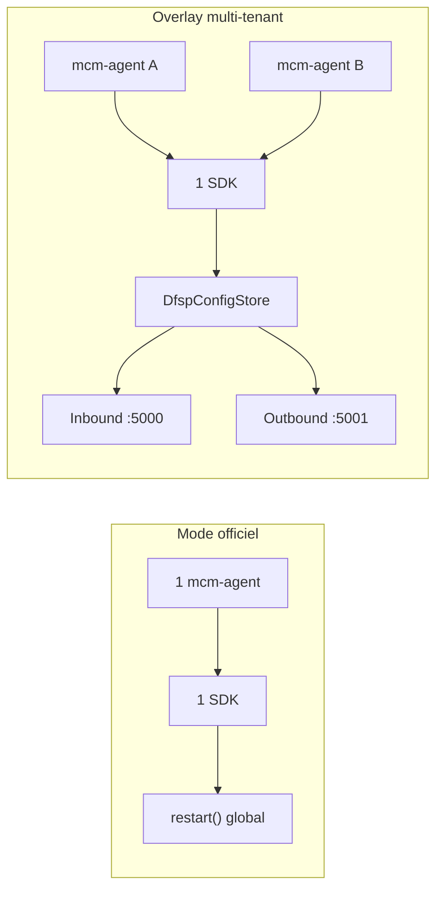
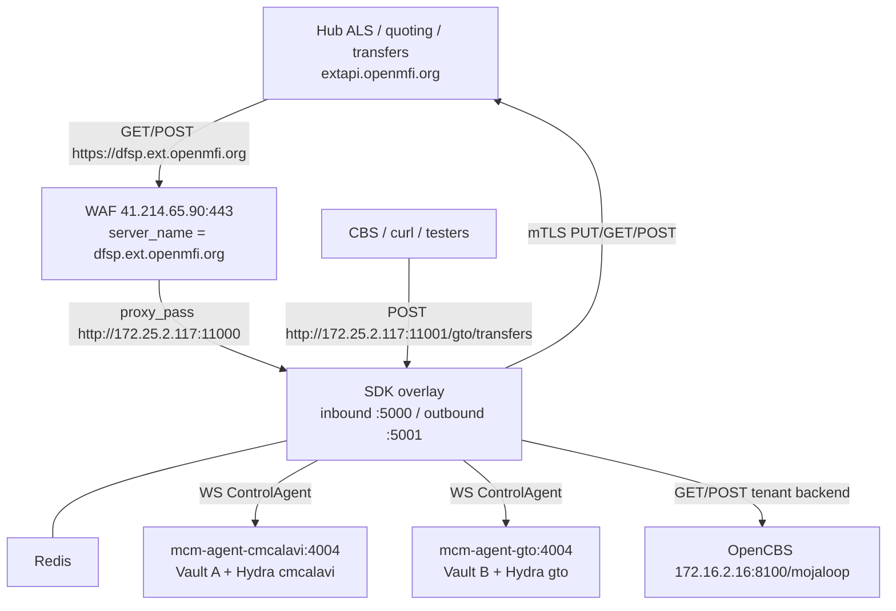
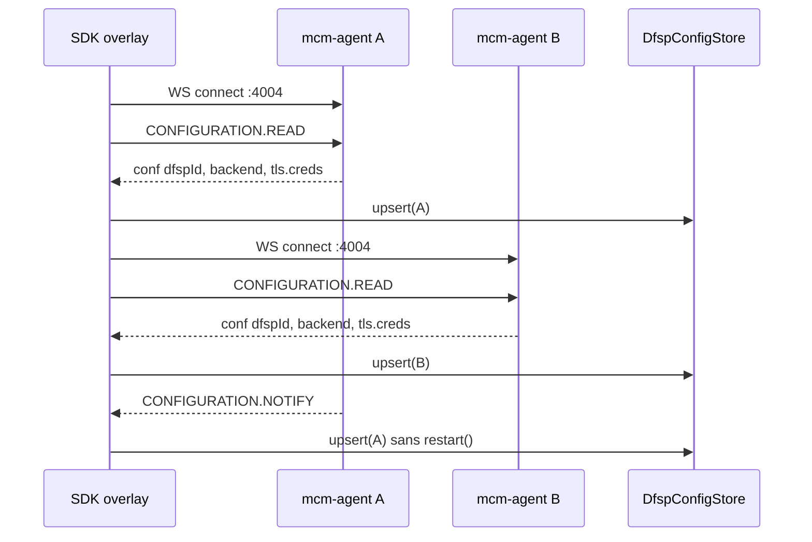
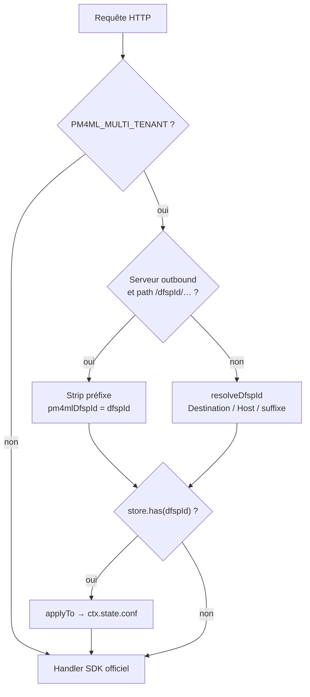
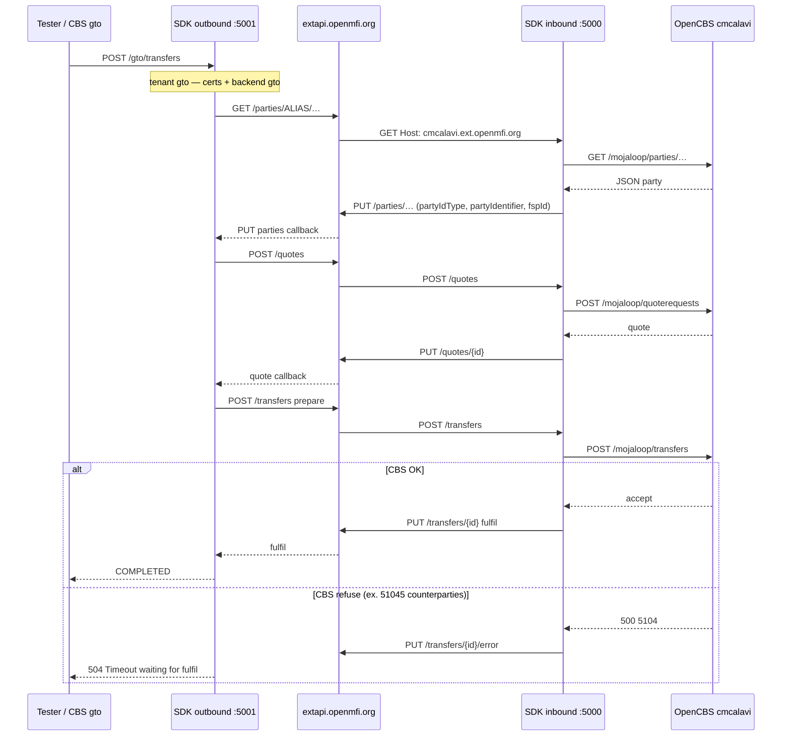
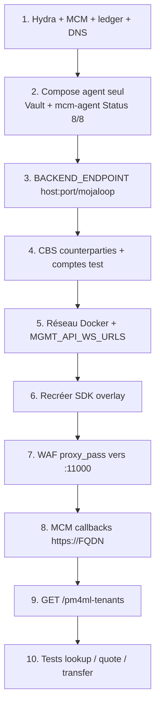

# Documentation technique — SDK scheme-adapter multi-tenant

[docs](../../docs/index.md) / [Participant](../../docs/participant/index.md) / SDK overlay

**Audiences:** opérateur hub (lab), opérateur DFSP, intégrateur CBS  
**Statut:** overlay opt-in sur `mojaloop/sdk-scheme-adapter:v24.9.0`. Ce n’est **pas** encore une PR Mojaloop. En lab openmfi, le mode supporté par défaut reste **N stacks Compose** (un SDK par DFSP). Ne basculer un DFSP réel qu’après un créneau de test dédié.

Compléments :

- Tableau comparatif overlay vs `v24.9.0` : [COMPARATIF.md](COMPARATIF.md)
- Déploiement réel (inventaire, WAF, tests) : [DEPLOY-REAL.md](DEPLOY-REAL.md)
- Cutover lab `cmcalavi` / `gto` : [lab/cutover-cmcalavi.md](lab/cutover-cmcalavi.md), [lab/cutover-gto.md](lab/cutover-gto.md)
- Onboarding DFSP classique (1 SDK) : [runbook](../../docs/participant/dfsp-onboarding-runbook.md), [Compose lab](../../docs/participant/dfsp-onboarding-compose-lab.md)

Les diagrammes Mermaid ci-dessous se rendent dans GitHub, GitLab, VS Code (extension Markdown Preview Mermaid) et [mermaid.live](https://mermaid.live).

---

## 1. Objectif

Le SDK officiel n’a qu’un `ControlAgent` et applique `CONFIGURATION.NOTIFY` par un `restart()` global des serveurs inbound/outbound. Avec **N** `mcm-agent` (N DFSPs), ce redémarrage casse les autres tenants.

L’overlay, activé par `PM4ML_MULTI_TENANT=true` :

- un **seul processus** SDK + un Redis ;
- **N** websockets PM4ML (`MGMT_API_WS_URLS`) ;
- un store mémoire `DfspConfigStore` : upsert par `dfspId` **sans** `restart()` ;
- résolution du tenant **par requête** (certs mTLS, JWS, `backendEndpoint`).



---

## 2. Ce qui est partagé vs ce qui reste 1:1

| Ressource | Partagé | Un par DFSP |
|-----------|---------|-------------|
| Processus `sdk-scheme-adapter` (image overlay) | oui | — |
| Redis du SDK overlay | oui | — |
| Port inbound Hub (conteneur `:5000`) | oui | — |
| Port outbound CBS (conteneur `:5001`) | oui — préfixe `/{dfspId}/` | — |
| `mcm-agent` + Vault + client Hydra | — | **oui** |
| `DFSP_ID`, FQDN, certs JWS / mTLS | — | **oui** |
| Backend CBS (`BACKEND_ENDPOINT`) | — | **oui** |
| Vhost WAF `https://<dfsp>.ext.openmfi.org` | — | **oui** (même `proxy_pass`) |
| UI MCM `mcm-<dfsp>.ext.openmfi.org` | — | **oui** (port hôte distinct) |

Le SDK **n’impose pas** un CBS unique. Chaque `NOTIFY` upsert `backendEndpoint` sous le `dfspId`.

---

## 3. Topologie lab (openmfi)

Valeurs de référence du lab actuel (nœud SDK `172.25.2.117`) :

| Rôle | Adresse |
|------|---------|
| WAF public | `41.214.65.90:443` |
| Hub FSPIOP (`extapi`) | `extapi.openmfi.org` → `172.16.2.28` (mTLS) |
| Overlay inbound | `172.25.2.117:11000` → conteneur `:5000` |
| Overlay outbound | `172.25.2.117:11001` → conteneur `:5001` |
| Overlay metrics | `172.25.2.117:11040` → conteneur `:5040` |

Le Hub **n’atteint pas** `172.25.2.117`. Les callbacks FSPIOP sont toujours `https://<DFSP_FQDN>` via le WAF.



---

## 4. Mode de fonctionnement

### 4.1 Image et fichiers overlay

Dockerfile : `FROM mojaloop/sdk-scheme-adapter:v24.9.0` puis copie de `overlay/modules/api-svc/src/` vers `/opt/app/modules/api-svc/src/`.

| Fichier overlay | Rôle |
|-----------------|------|
| `lib/DfspConfigStore.js` | Map globale `dfspId` → slice (backend, TLS, JWS, endpoints) |
| `config.js` | `PM4ML_MULTI_TENANT`, `MGMT_API_WS_URLS`, `DFSP_HOST_SUFFIX` |
| `index.js` | N clients ControlAgent, upsert, **pas** de `restart()` à chaque NOTIFY |
| `ControlAgent/index.js` | Protocole `CONFIGURATION.READ` / `NOTIFY` |
| `InboundServer/middlewares.js` | `resolveDfspId`, `applyPm4mlTenant` |
| `InboundServer/index.js` | `GET /pm4ml-tenants` |
| `InboundServer/handlers.js` | Wrap lookup (ids `partyIdType` / `partyIdentifier`) |
| `OutboundServer/index.js` | `stripPm4mlOutboundPrefix` |
| `OutboundServer/handlers.js` | Applique le tenant avant `OutboundTransfersModel` |

### 4.2 Chargement des tenants (PM4ML)

1. Au démarrage, le SDK parse `MGMT_API_WS_URLS`.
2. Format recommandé : `dfspId@hostname:port` (l’ancre `dfspId@` sert si le NOTIFY n’envoie pas `dfspId`).
3. Pour chaque entrée : websocket vers `mcm-agent:<4004>` (réseau Docker, **non** publié sur l’hôte).
4. `CONFIGURATION.READ` puis `NOTIFY` → `dfspConfigStore.upsert(...)`.
5. Les serveurs HTTP restent up. Un nouveau NOTIFY **écrase** le slice du tenant (certs, backend).

Les IDs `placeholder`, `mojaloop` et chaîne vide sont ignorés.



### 4.3 Contenu d’un slice tenant

Champs retenus (extrait) : `dfspId`, `backendEndpoint`, `peerEndpoint` / ALS / quotes / transfers, `jwsSigningKey`, `peerJWSKeys`, `outboundTls.creds` (`ca`, `cert`, `key`).

Règles :

- Les endpoints **sans** schéma `http://` (le modèle inbound préfixe tout seul).
- `BACKEND_ENDPOINT=127.0.0.1:9` du Compose est un placeholder : ignoré si le NOTIFY fournit une vraie valeur.
- Si un NOTIFY arrive **sans** PEM client alors que le store en a déjà, les certs existants sont **conservés**.

`applyTo(baseConf, dfspId)` fusionne le slice dans la conf de **cette** requête uniquement (`ctx.state.conf`).

### 4.4 Résolution du tenant

**Inbound Hub** — chemins FSPIOP **sans** préfixe (`/parties`, `/quotes`, `/transfers`). Ordre dans `resolveDfspId` :

1. `FSPIOP-Destination` s’il est déjà dans le store ;
2. premier segment de path s’il est un tenant (peu utilisé en inbound) ;
3. `Host` moins `DFSP_HOST_SUFFIX` (ex. `gto.ext.openmfi.org` → `gto`) ;
4. `FSPIOP-Destination` tel quel ;
5. premier label du Host s’il est dans le store ;
6. si **un seul** tenant chargé, celui-là.

**Outbound CBS** — préfixe obligatoire `/{dfspId}/…`. Middleware `stripPm4mlOutboundPrefix` : `POST /gto/transfers` devient `POST /transfers` avec `pm4mlDfspId=gto`. Sans préfixe, le SDK ne sait pas quel cert / backend utiliser.



### 4.5 Debug tenants

```bash
curl -sS http://127.0.0.1:11000/pm4ml-tenants
```

Réponse type :

```json
{
  "tenants": ["cmcalavi", "gto"],
  "tls": [
    {
      "dfspId": "cmcalavi",
      "backendEndpoint": "172.16.2.16:8100/mojaloop",
      "outboundCertBytes": 2060,
      "outboundKeyBytes": 3284,
      "certHead": "-----BEGIN CERTIFICATE-----"
    }
  ]
}
```

Attendre que les deux agents aient NOTIFY (quelques secondes après le start). `Connection reset` sur `/pm4ml-tenants` = inbound pas encore up.

---

## 5. Flux FSPIOP (transfert outbound)

Exemple lab : **gto** paie **cmcalavi**, alias payee `D865307F4F383`.



Contrats backend OpenCBS (chemin **sous** `/mojaloop`) :

| Étape SDK | Appel backend |
|-----------|----------------|
| Lookup inbound | `GET /parties/{idType}/{idValue}` |
| Quote inbound | `POST /quoterequests` |
| Prepare inbound | `POST /transfers` |

`:8100` **sans** `/mojaloop` est le SPA Granian (GET HTML, POST → 405). Toujours `host:port/mojaloop`, **sans** `http://`.

Wrap overlay lookup : si le CBS omet `idType` / `idValue`, les handlers remplissent `partyIdInfo` avant le PUT Hub (évite 3102 `partyIdType` manquant).

---

## 6. Configuration

### 6.1 Variables SDK overlay

| Variable | Lab actuel | Notes |
|----------|------------|--------|
| `PM4ML_ENABLED` | `true` | Active ControlAgent |
| `PM4ML_MULTI_TENANT` | `true` | Sinon comportement officiel (1 agent, `restart()`) |
| `DFSP_HOST_SUFFIX` | `.ext.openmfi.org` | Découpe le Host inbound |
| `MGMT_API_WS_URLS` | `cmcalavi@mcm-agent-cmcalavi:4004,gto@mcm-agent-gto:4004` | Noms = `container_name` Docker |
| `DFSP_ID` | `placeholder` | Ne pas laisser un vrai ID (serait upserté globalement) |
| `CACHE_URL` | `redis://redis:6379` | Redis **du** compose overlay |
| `PEER_ENDPOINT` / ALS / quotes / transfers | `extapi.openmfi.org` | Hub |
| `BACKEND_ENDPOINT` | fallback `172.16.2.16:8100/mojaloop` | Écrasé par NOTIFY agent |
| `INBOUND_LISTEN_PORT` | `5000` | |
| `OUTBOUND_LISTEN_PORT` | `5001` | |
| `INBOUND_MUTUAL_TLS_ENABLED` | `false` | TLS terminé au WAF |
| `OUTBOUND_MUTUAL_TLS_ENABLED` | `true` | Certs **par tenant** (NOTIFY) |
| `JWS_SIGN` / `VALIDATE_INBOUND_JWS` | lab : souvent `false` | Prod : JWS par tenant |
| `ENABLE_*_EVENT_HANDLER` | `false` | Pas de Kafka dans ce POC |
| `NODE_TLS_REJECT_UNAUTHORIZED` | `0` | Lab uniquement |
| `extra_hosts` | `extapi.openmfi.org:172.16.2.28` | Évite le WAF pour le client mTLS |

`MULTI_DFSP` (préfixe de chemin **backend**) est un autre flag officiel. En multi-tenant PM4ML, le routeur inbound le désactive (`multiDfsp: false`) pour ne pas exiger `/cmcalavi/parties` côté Hub.

### 6.2 Variables par agent (inchangées)

Dans le `.env` de **chaque** stack agent :

- `DFSP_ID`, `DFSP_FQDN`
- `AUTH_CLIENT_ID` / secret Hydra
- `BACKEND_ENDPOINT` (`host:port/mojaloop`, sans schéma)
- `extra_hosts` : `hydra` / `mcm` → WAF, `extapi` → `172.16.2.28`

Le NOTIFY agent **écrase** le fallback Compose du SDK. Changer le backend ⇒ recréer **l’agent** (pas seulement le SDK).

### 6.3 Ports hôte à ne pas réutiliser

Tant que les stacks 1-SDK-par-DFSP tournent, ne pas réutiliser 4000–10103. Overlay lab : inbound `11000`, outbound `11001`, metrics `11040`. UI MCM : ports **existants** de chaque agent (`3000`, `5003`, …).

---

## 7. Déploiement lab (overlay)

Prérequis nœud SDK : Docker + Compose, agents `mcm-agent-<id>` déjà up, réseaux Docker inspectables.

### 7.1 Réseaux

Le SDK doit être sur le réseau Docker de **chaque** agent (sinon le WS `mcm-agent-…:4004` ne résout pas).

```bash
cd ~/sdk-fececam/sdk-scheme-adapter-multi-tenant   # clone réel

export CMCALAVI_DOCKER_NET=$(docker inspect mcm-agent-cmcalavi \
  -f '{{range $k,$v := .NetworkSettings.Networks}}{{println $k}}{{end}}' | head -1)
export GTO_DOCKER_NET=$(docker inspect mcm-agent-gto \
  -f '{{range $k,$v := .NetworkSettings.Networks}}{{println $k}}{{end}}' | head -1)
export IN=11000 OUT=11001 MET=11040
```

### 7.2 Arrêt des SDK dédiés (cutover)

Ne **pas** arrêter Vault / mcm-agent / Redis des DFSPs. Stopper seulement le processus SDK 1:1 du DFSP que l’on bascule, puis pointer le WAF vers `:11000`.

```bash
docker update --restart=no sdk-scheme-adapter-<dfspId>
docker stop sdk-scheme-adapter-<dfspId>
```

### 7.3 Build et start

```bash
docker compose -f lab/docker-compose.yml up --build -d
sleep 15
curl -sS http://127.0.0.1:11000/pm4ml-tenants
docker exec sdk-mt-sdk-1 getent hosts mcm-agent-gto
docker exec sdk-mt-sdk-1 getent hosts mcm-agent-cmcalavi
```

Attendu : `"tenants"` contient tous les IDs listés dans `MGMT_API_WS_URLS`.

### 7.4 WAF

Pour **chaque** FQDN DFSP overlay :

```nginx
server {
    listen 443 ssl;
    http2 on;
    server_name <DFSP_ID>.ext.openmfi.org;
    # … certs zone openmfi.org …
    location / {
        proxy_pass http://172.25.2.117:11000;
        proxy_http_version 1.1;
        proxy_set_header Host $host;
        proxy_set_header FSPIOP-Destination $http_fspiop_destination;
        proxy_set_header FSPIOP-Source $http_fspiop_source;
        proxy_pass_request_headers on;
    }
}
```

`mcm-<id>.ext.openmfi.org` reste sur le **port MCM de cet agent** (pas `:11000`).

```bash
nginx -t && systemctl reload nginx
curl -sS -o /dev/null -w "%{http_code}\n" https://<DFSP_ID>.ext.openmfi.org/ping
# 405 = vhost OK (pas de GET /ping FSPIOP)
```

HTTP `:80` : ajouter les FQDN au `server_name` du `return 301 https://…`.

### 7.5 Callbacks MCM

Tous les `FSPIOP_CALLBACK_URL_*` = origine `https://<DFSP_FQDN>` (pas d’IP, pas de `http://`, pas de path `/quotes`). Un callback `http://` subit un 301 WAF → quote 1001.

### 7.6 Appels outbound

| Action | URL |
|--------|-----|
| Transfert en tant que gto | `POST http://127.0.0.1:11001/gto/transfers` |
| Lookup en tant que cmcalavi | `GET http://127.0.0.1:11001/cmcalavi/parties/…` |

Le CBS de chaque caisse doit viser `http://172.25.2.117:11001/<dfspId>/…` une fois le DFSP sur l’overlay.

### 7.7 Tests minimaux

1. `GET /pm4ml-tenants` : tous les IDs, `backendEndpoint` avec `/mojaloop`, `outboundCertBytes` > 0.
2. Inbound : `Host: <dfsp>.ext.openmfi.org` + `FSPIOP-Destination` → **202** sur `GET /parties`.
3. Outbound : `POST /<payer>/transfers` → lookup + quote (logs `quoteRequest is done`).
4. Fulfil : `COMPLETED` seulement si le **payee CBS** accepte `POST /mojaloop/transfers` (voir §9).
5. Logs : pas de `http://http://`, pas de `restart()` inbound à chaque NOTIFY.

POC isolé (mocks, pas de Hub) :

```bash
docker compose -f poc/docker-compose.yml up --build
./poc/smoke.sh
```

---

## 8. Connecter un nouveau DFSP

Deux cas : (A) DFSP **déjà** onboardé en stack 1:1 — cutover overlay ; (B) DFSP **nouveau** — onboarding complet puis branchement overlay.

### 8.1 Prérequis — à obtenir avant toute action

#### Hub / switch (opérateur)

- [ ] Identifiant `<DFSP_ID>` unique, casse exacte (Hydra `client_id` = MCM = central-ledger = Host).
- [ ] Client Hydra `client_credentials` + secret.
- [ ] Enregistrement MCM, zone devise (lab : `XOF`).
- [ ] Participant **central-ledger** (comptes, NDC) — sinon prepare Hub timeout / erreur ledger.
- [ ] Endpoint Hub FSPIOP : `extapi.openmfi.org` + CA Hub pour mTLS.
- [ ] Droit de créer DNS `A` : `<DFSP_ID>.ext.openmfi.org` et `mcm-<DFSP_ID>.ext.openmfi.org` → WAF (`41.214.65.90`), **pas** l’IP SDK.
- [ ] Accès WAF nginx (vhost 443 + redirect 80).
- [ ] Certificat TLS WAF dont le SAN couvre `*.ext.openmfi.org` (pas un SAN `cbs.…` étranger).

#### DFSP / CBS

- [ ] Connecteur OpenCBS (ou équivalent) joignable depuis le nœud SDK (`host:port/mojaloop`).
- [ ] Parties lookup : `GET /mojaloop/parties/{idType}/{idValue}` → JSON (pas HTML SPA).
- [ ] Quotes : `POST /mojaloop/quoterequests`.
- [ ] Transfers : `POST /mojaloop/transfers`.
- [ ] Table **`cbs.counterparties`** (ou équivalent) : contrepartie pour **chaque** FSP payer qui créditera cette caisse. Sans ligne pour `gto` sur le tenant cmcalavi → `51045`, rien n’est écrit, le SDK outbound fait 504 fulfil.
- [ ] Si le CBS initie des paiements : il appellera `http://<SDK_HOST>:<OUT>/<DFSP_ID>/transfers` (préfixe obligatoire).
- [ ] Alias / MSISDN de test mappés dans le CBS **et** connus du Hub ALS si lookup croisé.

#### Nœud SDK / Docker

- [ ] Nœud overlay (lab : `172.25.2.117`), Docker daemon up.
- [ ] Clone overlay + image buildable (`mojaloop/sdk-scheme-adapter:v24.9.0` pullable).
- [ ] Ports hôtes libres pour **cet** agent MCM (UI). Inbound/outbound overlay **déjà** `11000`/`11001` — on ne crée **pas** un nouveau couple inbound Hub.
- [ ] Stack **agent seul** : Vault + `mcm-agent` + `default.json` (`tokenPath` `/oauth2/token`). **Pas** de `sdk-scheme-adapter` dans ce Compose.
- [ ] Port agent `4004` exposé **uniquement** sur le réseau Docker (`expose`, pas `ports:` public).
- [ ] `container_name` stable : `mcm-agent-<DFSP_ID>` (doit matcher `MGMT_API_WS_URLS`).
- [ ] CSR signés jusqu’à Status MCM **8/8** (certs inbound/outbound dans Vault).
- [ ] `extra_hosts` agent : Hydra/MCM → WAF, `extapi` → `172.16.2.28`.

#### Overlay déjà en place

- [ ] Compose `lab/docker-compose.yml` : ajouter le réseau externe de **ce** nouvel agent.
- [ ] Variable `MGMT_API_WS_URLS` : concaténer `<id>@mcm-agent-<id>:4004`.
- [ ] Recréer le SDK (`up --build`) après modification des WS / networks.

Ne pas changer le CoreDNS / extra_hosts **moov** (ni les autres DFSPs hors overlay) pour un onboarding overlay.

### 8.2 Procédure — nouveau DFSP (B)



1. **Hub** — Hydra, MCM, participant ledger (runbook §3).
2. **DNS** — deux records `A` vers le WAF.
3. **Agent Compose** — template [dfsp-onboarding-compose-lab.md](../../docs/participant/dfsp-onboarding-compose-lab.md), **sans** service SDK. Signer jusqu’à 8/8.
4. **Backend** — vérifier depuis le nœud SDK :
   ```bash
   wget -qO- "http://<CBS>:810x/mojaloop/parties/ALIAS/<id>"
   ```
   JSON attendu, pas un dump HTML.
5. **CBS** — comptes, aliases, **counterparties** pour les FSP avec lesquels on échangera (au minimum le payer du premier test).
6. **Overlay** — `docker inspect mcm-agent-<id>` pour le nom de réseau ; l’ajouter dans `lab/docker-compose.yml` (`external: true`) + `MGMT_API_WS_URLS`.
7. **Rebuild SDK** — `docker compose -f lab/docker-compose.yml up --build -d`.
8. **WAF** — vhost DFSP → `http://172.25.2.117:11000` ; vhost `mcm-` → port UI agent.
9. **MCM** — callbacks `https://<DFSP_FQDN>`.
10. **Vérif** — `/pm4ml-tenants` contient `<DFSP_ID>` ; inbound 202 ; outbound préfixé.

### 8.3 Procédure — cutover DFSP existant (A)

1. Ne pas arrêter l’agent / Vault.
2. Stopper `sdk-scheme-adapter-<id>` (`--restart=no`).
3. Joindre son réseau Docker au compose overlay + WS URL.
4. Recréer l’overlay ; vérifier que les **autres** tenants sont toujours dans `/pm4ml-tenants`.
5. Basculer le vhost WAF de `:<ancien inbound>` vers `:11000`.
6. Pointer le CBS outbound vers `:11001/<dfspId>/`.
7. Retour arrière : WAF vers l’ancien inbound, relancer le SDK dédié, retirer l’entrée WS.

Pas de nouveau port inbound Hub.

---

## 9. Incidents connus (lab)

| Symptôme | Cause | Action |
|----------|--------|--------|
| PUT `/parties` 400 3102 `partyIdType` | Corps CBS incomplet | Wrap overlay `ensureInternalPartyIds` (déjà dans handlers) |
| Quote timeout, POST backend 405 | `BACKEND_ENDPOINT` sans `/mojaloop` (SPA Granian) | `.env` agents + fallback Compose + recréer agents |
| Lookup HTML dans les logs | Même cause | GET `/mojaloop/parties/…` doit être JSON |
| 504 `Timeout waiting for fulfil` + CBS 500 `51045` | Pas de contrepartie payer dans `cbs.counterparties` | Config CBS payee ; overlay OK jusqu’au quote |
| PUT Hub `/transfers/…/error` 400 3102 `errorCode` | SDK mappe mal l’Axios 500 CBS → `{errorInformation:{}}` | Secondaire ; corriger d’abord le 51045 |
| `/pm4ml-tenants` `[]` ou reset | WS agent down / mauvais réseau / inbound pas prêt | `getent hosts mcm-agent-…` ; attendre ; ancre `id@` |
| Quote 1001 | Callback MCM en `http://` | Origine `https://FQDN` |
| `http://http://…` | Schéma dans `BACKEND_ENDPOINT` | Retirer `http://` |
| Cert SAN mismatch | Cert WAF ≠ Host DFSP | Hors overlay |

Ne pas coller les dumps axios complets : le logger Axios peut y mettre les PEM mTLS.

---

## 10. Limites et hors périmètre

- Overlay **communautaire / lab**, pas le défaut production.
- Un Redis et un process SDK = point unique de défaillance pour N DFSPs.
- Store tenants **en mémoire** : perdu au restart jusqu’au prochain NOTIFY (quelques secondes).
- Ne pas fusionner moov/mtn/clcam-\* sur cet overlay tant que le cutover n’est pas validé DFSP par DFSP.
- `MULTI_DFSP` (préfixe backend) ≠ `PM4ML_MULTI_TENANT` (préfixe outbound + Host inbound).
- Contribution Mojaloop éventuelle : flag off par défaut, tests d’intégration à deux agents mock.
